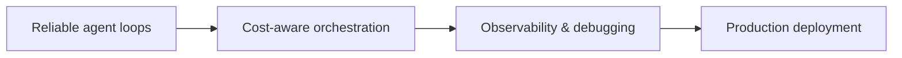

<!-- DARSHIT PATEL | PROFILE README | RECRUITER-OPTIMIZED -->
<div align="center">


<br>

[](https://darshitpatel.me/)
[](https://www.linkedin.com/in/darshitp091/)
[](mailto:darshitp091@gmail.com)
[](https://github.com/darshitp091)


</div>

##  Player Profile

```text
╔════════════════════════════════════════════════════════════════════╗
║  PLAYER  : Darshit Patel                                          ║
║  CLASS   : AI Systems Builder + Full-Stack Developer              ║
║  BASE    : India                                                  ║
║  STUDY   : B.Tech Computer Science, NIMS University (2023–2027)   ║
║  QUEST   : Engineer useful, reliable, measurable AI products      ║
║  STATUS  : Open to internships, graduate roles, and collaborations║
╚════════════════════════════════════════════════════════════════════╝
```

I build end-to-end products that combine **Python, modern web engineering, language models, and applied computer vision**. My strongest work sits where software meets an operational problem: offline voice assistants, agent reliability middleware, real-time web platforms, browser automation, and AI-powered business tools.

I am not optimized for "demo-only" projects. I care about state management, failure modes, latency, local-first privacy, cost controls, observability, and a clear path from prototype to use.

### Profile Readme Formula: **C–A–T–I**

| Step | Recruiter-facing question | How I answer it |
|:---:|:---|:---|
| **C** | What problem existed? | Start with the real constraint or user pain. |
| **A** | What did you personally design/build? | Name the architecture, stack, and engineering decisions. |
| **T** | What trade-off did you manage? | Explain cost, latency, privacy, reliability, or complexity. |
| **I** | What changed because of the build? | State verified behavior, capability, or product outcome—never invent metrics. |

---

##  Recruiter Quick View

| Dimension | Evidence |
|:---|:---|
| Primary stack | Python, TypeScript, JavaScript, Next.js, React, FastAPI, Node.js |
| AI / ML | RAG, LLM orchestration, Whisper fine-tuning, Ollama, Groq, LangGraph, PyTorch/LoRA |
| Applied vision | MediaPipe, OpenCV, hand gestures, eye-gaze tracking |
| Data / backend | PostgreSQL, Supabase, REST APIs, WebSockets, PL/pgSQL |
| AI infrastructure | Cost budgets, circuit-breaking, model fallback routing, local-first inference |
| Engineering habits | Typed interfaces, modular architectures, reproducible setup, README-first documentation |
| Portfolio | [darshit-portfolio-eta.vercel.app](https://darshit-portfolio-eta.vercel.app/) |

---

##  Flagship Build Log

### 01 | JARVIS — Privacy-First Spatial AI Assistant

<p>
  <a href="https://github.com/darshitp091/Jarvis"></a>
</p>

**C — Context:** Typical desktop assistants depend on the cloud and do not provide rich, hands-free spatial control.

**A — Architecture:** Built a Python desktop control system with fine-tuned Whisper-style Hinglish speech understanding, MediaPipe hand tracking, eye-gaze tracking, neural TTS, Ollama/local model routing, cloud fallback, and OS automation.

**T — Trade-offs:** Balanced privacy and capability by prioritizing local inference while retaining explicit fallback paths for tasks that need more compute.

**I — Impact:** Demonstrates an end-to-end local AI workflow—from microphone input and vision signals to agent decisions and executable desktop actions—rather than a disconnected model demo.

<p>
  
  
  
  
  
  
</p>

---

### 02 | Agent Circuit Breaker — Reliability Middleware for AI Agents

**C — Context:** Multi-agent systems can loop, drift, and generate redundant tool calls until latency and API cost become uncontrolled.

**A — Architecture:** Designed middleware for LangGraph, CrewAI, and AutoGen workflows using semantic loop detection, TF-IDF cosine similarity, edit-distance analysis, state checkpoints, cost budgets, time-travel debugging, and PyTorch LoRA support.

**T — Trade-offs:** Added multiple detection signals instead of relying on one similarity rule, balancing false positives with the need to stop runaway execution quickly.

**I — Impact:** Moves agent reliability concerns outside the prompt and into a reusable middleware layer, making multi-agent behavior more observable and easier to control.

<p>
  
  
  
  
  
  
</p>

---

### 03 | TypeLively — Real-Time Typing Experience

<p>
  <a href="https://github.com/darshitp091/TypeLively"></a>
</p>

**C — Context:** A typing game should feel immediate, retain accurate test state, and remain fair across concurrent users.

**A — Architecture:** Built with Next.js 16, React 19, TypeScript, Supabase real-time channels, a sliding word window, server-side bot rejection, and Web Audio for generated mechanical-keyboard feedback.

**T — Trade-offs:** Used a bounded DOM rendering window and real-time synchronization to protect low-latency interaction instead of rendering an entire test at once.

**I — Impact:** Combines live state, competitive leaderboards, audio feedback, and abuse resistance in one browser-native product.

<p>
  
  
  
  
  
  
</p>

---

### 04 | BolKe — Voice-to-Storefront Pipeline

<p>
  <a href="https://github.com/darshitp091/BolKe"></a>
</p>

**C — Context:** Small-business owners need a faster route from spoken requirements to an industry-specific online presence.

**A — Architecture:** Built a distributed pipeline for speech capture, transcription, LLM inference, generated storefront structure, and dynamic React rendering across multiple business verticals.

**T — Trade-offs:** Designed provider fallback around inference availability while keeping the generated experience modular enough for different industries.

**I — Impact:** Turned a natural-language input workflow into a repeatable generation pipeline instead of a static landing-page template.

<p>
  
  
  
  
  
  
</p>

---

##  More Missions

| Project | Mission | Core Engineering |
|:---|:---|:---|
| [Chess Engine](https://github.com/darshitp091/chess-engine) | Deterministic fixed-node chess engine for a 4 KB Python bounty | Search constraints, fixed-node logic, Python optimization |
| [Readme.3D](https://github.com/darshitp091/Readme.3D) | Immersive 3D README experience with AI-assisted documentation synthesis | Gemini integration, TypeScript, generated web UI |
| [YourCV](https://github.com/darshitp091/YourCV) | Open-source AI resume builder focused on ATS-friendly output | Google Gemini, LaTeX-style templates, JavaScript |
| [RoadSter Free Racing](https://github.com/darshitp091/RoadSter-Free-Racing) | Racing game experience | TypeScript, game-state design, frontend interaction |
| [Facebook Lead Follow-Up](https://github.com/darshitp091/Facebook-Lead-Finde-Follow-Ups) | Automated lead capture and personalized follow-up | n8n, Google Sheets, Gmail, OpenRouter |
| [WhatsApp Booking Assistant](https://github.com/darshitp091/Whatsapp-Booking-Assistant-Automation) | Booking automation workflow | Python, conversational automation, integrations |

---

##  Engineering Loadout

<div align="center">

### Languages & Runtime


### Frameworks & Data


### AI, Cloud & Tools


</div>

### Skill XP

```text
Python & applied automation       ████████████████████░  94%
Full-stack TypeScript / Next.js   ██████████████████░░░  88%
LLM systems & orchestration       █████████████████░░░░  84%
Computer vision & multimedia AI   ████████████████░░░░░░  78%
RAG / vector databases / scaling  ██████████████░░░░░░░░  70%
```

> XP bars represent a personal learning map, not formal benchmarks or company ratings.

---

##  GitHub Telemetry

<div align="center">


</div>

---

##  Certifications & Continuous Learning

- Google Cloud — Prompt Engineering & AI
- Google Cloud — Vertex AI Prompt Design
- Deloitte — Technology Consulting
- Deepening: RAG architectures, vector databases, distributed AI, Kubernetes, and production MLOps

---

##  Current Build Queue



- **Exploring:** RAG evaluation, vector search, distributed inference, Kubernetes
- **Strengthening:** system design, testing, deployment, data pipelines
- **Open to:** AI Engineer, Full-Stack Developer, Python Developer, and SDE internship opportunities

---

##  Establish Contact

<div align="center">

[](https://www.linkedin.com/in/darshitp091/)
[](mailto:darshitp091@gmail.com)
[](https://darshit-portfolio-eta.vercel.app/)


</div>
